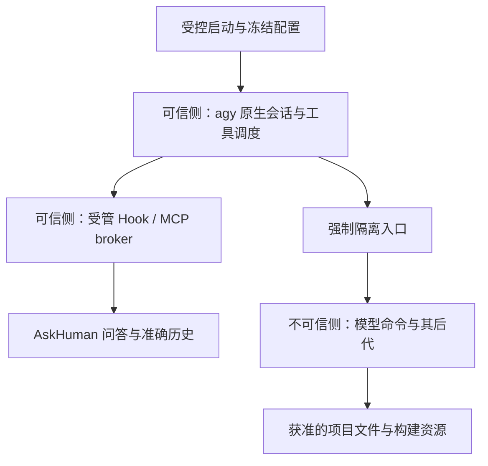

# Antigravity 受控启动与强制隔离：能力限制及可行性

2026-10-18。用户批准有界研究，要求先交付能力限制和可行性，不部署、不跑原生探针。维持原 v1：本机 NixOS、agy CLI、可信 MCP 六工具、exact CID 恢复、单 canonical 项目、Popup 与自动模式兼容目标。

## 结论

**存在值得做最小资格验证的候选，但目前不足以进入产品实现。** 最小候选是“受控配置与启动 + agy 原生 terminal sandbox + 可信侧保护”，不是开发新的通用 sandbox，也不是把整个 agy 放进一个容器就算完成。

候选的工程价值在于尽量复用原生执行入口；最大不确定性在于能否强制覆盖全部模型执行及修改路径、禁止绕过，并保护 native 和 broker 通道。这些条件未建立前，不应继续扩写来源 adapter、broker 产品代码或跑六工具长等待矩阵。

当前结论分级：

- 设计层面：条件可行，所需边界能够明确描述。
- 已安装 1.3.5：只有接口候选证据，没有完整强制性证明。
- 普通 unrestricted 运行：不能套用候选认证；不能把运行限制悄悄加给现有使用方式。
- 产品准入：No-Go，直到下述 G1–G3 有证据；不是认定所有未来机制均不可行。

## 本轮依据与适用性

本地 binary 身份沿用[前份调查](antigravity-trusted-source-feasibility-135.md)。只读核对历史保存的 1.3.5 `native-help.txt`，其中存在 `--sandbox`、`--agent`、`--project`、`--add-dir`、`--mode`；没有执行新的 help/native 命令。包内可检索到 sandbox 配置及 MCP metadata 字符串，但字符串不证明执行路径、配置优先级或强制性。

当前官方 CLI 文档提供 sandbox 开关、权限规则、命令绕过机制。CLI 权限的 deny 优先于 ask/allow，并有 `unsandboxed` action。这给出“强制禁止绕过”的候选配置方向，但网页未绑定本地 build，也没有完成所有工具路径的安全证明。[Sandbox](https://antigravity.google/docs/sandbox/)、[Permissions](https://antigravity.google/docs/permissions)

官方说明 subagent 继承 sandbox/权限设置，同时允许自定义 agent 配置和 MCP server；因此 child 必须纳入强制性检查，不能用 parent 单次成功代替。[Subagents](https://antigravity.google/docs/subagents)

CLI settings 区分自动批准与 sandbox 设置。这支持把“边界内自动执行”作为候选目标，但不证明本机 always-proceed 与 deny/sandbox 的组合行为。研究不会将关闭自动模式作为默认解法。[Settings](https://antigravity.google/docs/settings?tab=cli)

Linux Landlock 能约束执行域及后代，但预先打开的文件/FD 具有不同限制语义；仅添加文件路径限制不能当作继承通道已被切断。seccomp 文档也明确 syscall filtering 本身不是完整 sandbox。这里是设计约束，没有声称本机已配置或验证这些设施。[Landlock](https://docs.kernel.org/userspace-api/landlock.html)、[Seccomp](https://docs.kernel.org/userspace-api/seccomp_filter.html)

## 最小候选边界

该图是待证设计。native 本身执行文件操作、加载插件/Hook 或调用其它 MCP 工具的路径，不会因为图上有 S 就自动受 S 保护。

可信侧必须保护：固定可执行文件、配置与 Hook/插件代码、native 请求/响应端点、来源记录、AskHuman 历史/待办/附件和管理接口。保护包括不能让不可信代码读、改、借用关键 FD、操作 native 内存或间接要求另一个工具代做这些动作。

受控启动负责固定版本、配置集合与生命周期，发现变化则停止准入；它不能仅凭启动 cwd 宣称项目权威，也不天然获得 native CID。人类给 launcher 选一个目录，不自动替代 v1 要求的原生逐调用项目合同。

优先保留普通 TUI 的可能性：如果受保护 Hook 与逐调用 metadata 足够，不必强行切 headless。只有确实需要 stream observer 时，再评估 headless 对使用方式的影响，不提前承诺两者等价。

## 日常能力会受到什么影响

以下为候选运行合同的预期限制，不是当前已部署行为或已实测兼容清单。

| 场景 | 候选处理 | 使用成本/未证条件 |
| --- | --- | --- |
| 编辑代码、rg、单元测试、本地构建 | 项目可写；固定工具链可读；有限缓存/临时目录可写 | Nix store closure、shell、编译器及缓存挂载需完整；不保证所有项目命令原样可用 |
| 自动模式连续工作 | 获准边界内保持自动执行；边界外拒绝而非自动提权 | 不等价于 unrestricted；必须验证 always-proceed 不能覆盖强制边界 |
| 拉依赖、访问远端仓库 | 配置有限网络与必要资源 | 任意网络、宿主服务通道不能默认开放；git 凭据/SSH agent 不能整包透传 |
| git diff/commit 等 | 在隔离侧执行项目工具 | hooks、filters、外部 diff 程序必须同样隔离；不能只按命令名字授予宿主执行 |
| git push、签名、SSH、系统运维 | 视所需凭据/服务另定受限通道，或由人类在外部完成 | 不承诺直接使用宿主 ssh-agent、签名代理、任意 SSH 或 sudo |
| Nix daemon、Docker/Podman socket、D-Bus、桌面自动化 | 不默认暴露管理 socket | 如果开放接口可启动宿主代码或扩大访问，隔离边界可能失效；会影响部分日常开发流程 |
| 项目 `.agents`、Hook、插件配置修改 | 可编辑的项目内容与实际加载的可信配置分开；变更需重新冻结 | 不能让 agent 写完配置马上在可信 native 侧执行；动态定制便利性下降 |
| 其它 MCP 工具/远程执行工具 | 逐个判断是否成为越界代理 | 不能默认继承所有已有 MCP server；具有文件/执行能力的服务也在攻击面内 |
| 主/child 并行 | 同样强制执行边界；来源仍逐调用区分 | 继承权限是候选依据，不足以认证 child 身份或并发关联 |
| AskHuman Popup、回答、准确 show_last | 通过受保护 broker 调用 | GUI 可在现有可信宿主侧；不需要为了 Popup 把完整桌面控制 socket 给模型命令 |
| 文件附件 | 明确路径与用途，经受限桥接交付 | 模型侧不可见的文件不能自动获得访问；桥接不能变成任意读写代理 |
| 运行中切项目/扩大根集合 | 已确认 v1 只准单 canonical 项目；未知变化使准入失效 | 不以 launcher cwd 强行继续；安全结束在途请求并重新验证新调用 |
| 退出受控启动、配置漂移、sandbox 不可用 | 新可信调用拒绝；在途请求沿既有单终态处理 | 不悄悄回退到普通模式继续标记可信 |

这些限制可能比纯 MCP 接线更影响使用体验。先确定能否强制执行，再由用户决定具体使用合同；本次研究授权不等于接受全部限制。

## 三种实现路径比较

| 路径 | 判断 | 理由 |
| --- | --- | --- |
| B1：冻结 native 配置，强制原生 sandbox，限制绕过与可信侧访问 | 唯一建议继续资格验证的最小候选 | 已有本地 flag 和官方权限接口；需要证明全部入口、配置不可改、FD/响应保护及 child 继承 |
| B2：仅在 agy 外套 bwrap/container/VM | 单独不足 | native 与 helper 若仍在同一安全域，外层只隔离它们与宿主，没有产生两者之间的认证边界 |
| B3：自建跨 UID 调度、syscall/exec 拦截或修改二进制的通用 supervisor | 暂不推荐 | 控制面、兼容性、信号/FD/子进程覆盖均成为新系统；尚未证明可比原任务更快交付，也不自动产生逐调用 CID/项目权威 |

不采用 LD_PRELOAD、ptrace 注入、二进制 patch 等方式作为无审查捷径。不扩大为完整安全运行时项目。

## G1–G3：下一步应该证明什么

### G1 强制边界：首先裁决

需要一份固定 profile 的执行入口表，覆盖 run_command、后代、child、后台任务、原生文件工具、Hook/插件加载、其它 MCP 与 native 间接执行项目代码。每条入口标明实际 enforcement、可信资源暴露、绕过规则和配置加载来源。

**Go 所需证据：** 不可信操作必须经过受保护的强制边界；危险绕过不能仅靠提示或事后日志发现；保护包括继承 FD、native 进程与响应、可信代码/状态。实际 denial 必须发生在受保护资源访问之前。合法普通操作也必须能成功，不能靠把所有工具都关掉通过。

**停止条件：** 任一实际代码执行或可信配置修改路径无法强制约束，或固定 binary 缺少足以审查 enforcement 的机制依据。此时不编写产品 adapter，不继续调用关联探针；输出上游缺口。有限负例全部失败也不能代替机制依据。

### G2 原生逐调用来源与精确响应

G1 通过后比较两个候选，均未实现：

- native 在实际 RPC 中覆盖保留 metadata，并绑定可信 CID/role/调用及项目证据；验证模型公参或 metadata 不能覆盖。
- 受保护 Hook 为该次调用注入短命一次凭据，绑定 source、role、工具、公参、项目、epoch，实际 MCP 调用领取并得到原调用响应。必须证明 Hook 对应真正调用、overwrite 传播与秘密不被模型可见日志/工具泄露；不能只用同参 hash/时间窗口匹配。

main/child、并发同参、重复、重排、抢先领取与重启都要有明确处理。任何机制仍依赖“模型不会读/猜/抢”则不准入。若 Hook 通道不能受保护，换 token 长度没有帮助。

### G3 项目权威

从受保护 native producer 获取完整、逐调用相关的 roots snapshot；验证 generation/变化失效，再严格归约到单 canonical project。官方 workspacePaths 描述和一次 singleton 样本只是候选输入，不证明完整性与生命周期。

这一步不能被受控启动固定 cwd、省略第二个 root 或手动指定项目替代。若要另改项目语义，仍是新的用户决定。

## 推荐的后续工作包

如继续，先做 **B1 资格预检准备**，不进入 adapter 开发：

1. 用现有证据列出 G1 入口表、每项机制依据和未知项，冻结候选配置语义；不要把示例 JSON 当作本机已接受的配置。
2. 如果缺机制依据，先整理具体上游问题；如果有可审查候选，再准备仅自有 canary、零业务数据的最小资格 fixture。
3. 运行前给出精确 binary/hash、argv、cwd、配置变更及恢复、可读文件、输出与资源上限、清理身份和停止条件，另行取得 native 执行授权。
4. 第一批只判 G1；没有通过，不扩展 G2/G3、不跑长等待矩阵。所有首次失败保留，但不为证明同一个失败不断重开 run。

当前仍缺 G1 的完整机制依据；所以本轮交付是“能力代价明确、下一可证问题明确”，不是“已发现可直接实现的安全方案”。最有价值的下一步是判断原生 sandbox 的强制覆盖能力，而不是先写 launcher UI 或更多合成 broker 测试。

## 本轮核验

已读取官方 CLI sandbox、permissions、settings、subagents 与 Linux kernel 文档；核对本地包及已保存 help、现行 v1/来源合同。未执行 agy、修改配置、读取生产历史/journal、部署、安装或运行原生探针。只新增调查报告，原 worktree 保持只读。

<!-- # VERIFY: Demonstrate G1 enforcement for every actual execution and trusted-state mutation path on the pinned local profile before claiming controlled-launch feasibility; G2/G3 and product validation remain separate gates. -->
